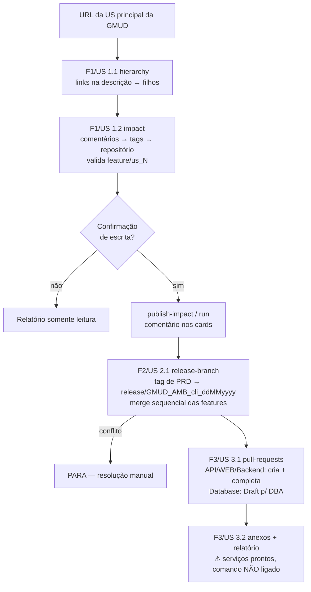

# Processo de GMUD — Regras de Negócio e Decisões

Fonte de verdade do *domínio*. Quando o código e este arquivo divergirem, o código manda — corrija este arquivo e avise o usuário.

## 1. Visão geral (Epic #185 — Automação e Orquestração do Processo de GMUD)

## 2. Backlog do produto (estado atual)

| Item | Escopo | Comando | Status |
|---|---|---|---|
| F1 / US 1.1 | Mapear hierarquia (US → Tasks/Bugs via links da descrição) | `hierarchy` | ✅ Pronto |
| F1 / US 1.2 | Impacto técnico via comentários + validação de branch | `impact`, `publish-impact`, `run` | ✅ Pronto |
| F2 / US 2.1 | Branch de release + merge sequencial + catch-up de GMUD | `release-branch` | ✅ Pronto |
| F3 / US 3.1 | PRs: auto-complete API/WEB/Backend, Draft para Database | `pull-requests` | ✅ Pronto |
| F3 / US 3.2 (Task 206) | Baixar, renomear `US<US>_SCRIPT_TASK<Task>` e reanexar scripts | — | 🟡 Serviço pronto (`AttachmentRenamingService`), falta comando |
| F3 / US 3.2 (Task 208) | Relatório consolidado de release na Task principal | — | 🟡 Serviço pronto (`ReleaseReportFormatter/Publisher`), falta comando |
| Fluxo automatizado (2026-11-04) | 11 etapas a partir do link da GMUD: itens → projetos/scripts → tag vigente → `feature/us_<GMUD>` → merges → conciliação → releases → build/infra.md; manifesto, dry-run, retomada | `run <link\|id>`, `status`, `report` | ✅ Pronto (validar com GMUD real em dry-run) |
| Futuro | Notificações (e-mail/Teams); abrir PRs a partir do manifesto | — | 💡 Ideia |

Atualize esta tabela sempre que um item mudar de status.

## 3. Regras de negócio

| ID | Regra | Onde no código |
|---|---|---|
| RN-GMUD-001 | Os filhos da GMUD são os work items **linkados na descrição HTML** da US principal (`/_workitems/edit/<id>`), não os links de hierarquia do board. | `WorkItemLinkParser`, `GmudHierarchyService` |
| RN-GMUD-002 | O repositório alterado é identificado por tags nos comentários: nome qualificado (`X.Y.API`/`.WEB`/`.Database`) ou tag curta (`API`, `WEB`, `Database`) resolvida pelo catálogo. | `ProjectTagExtractor` |
| RN-GMUD-003 | Se a US não tem tag nos próprios comentários, procura nos comentários dos seus filhos (Tasks/Bugs). | `TechnicalImpactService` |
| RN-GMUD-004 | A branch de feature é sempre `feature/us_<id da User Story>`, mesmo que a tag tenha vindo de uma Task. | `TechnicalImpactService` |
| RN-GMUD-005 | Nome da branch de release: `release/GMUD_<GMUD\|PROD>_<cliente>_<ddMMyyyy>` (data do dia da execução). | `ReleaseBranchNameBuilder` |
| RN-GMUD-006 | A release parte **sempre** da tag/branch publicada no App Service de **produção** (`prd`), qualquer que seja o ambiente-alvo. | `Program.cs` (`ProductionSiteSuffix`) |
| RN-GMUD-007 | Catch-up: se a branch hoje publicada no App Service de GMUD do cliente teve build há **< 14 dias**, ela também é mesclada na release. | `TryGetRecentGmudCatchUpBranchAsync` |
| RN-GMUD-008 | Merge sequencial; ao primeiro conflito o processo **para** e devolve log legível. | `IntegrationBranchService`, `MergeConflictException` |
| RN-GMUD-009 | Database usa **só** a `feature/us_<idUS>` criada pelo desenvolvedor: sem `feature/us_<GMUD>`, merge, conciliação ou release. Em **toda** user story da GMUD a etapa 6 procura essa branch e conta os commits (sem merges) à frente da branch padrão do repositório: com commit = "alterada" (link da branch no manifesto, no `status` e no `infra.md`); sem commit = aviso. A alteração é detectada pela branch — "procedure" **não** é alias. Card que cita o Database (nome/alias/link) sem a branch bloqueia; só anexo de script não exige branch. Nenhum outro repositório pode ficar sem App Service. | `StoreInformationStep`, `FetchCurrentTagsStep`, manifesto `banco` |
| RN-GMUD-010 | PRs de `Database` ficam Draft/Ativa (aprovação do DBA); demais são completadas automaticamente se as políticas permitirem. Após completar, captura-se o último build ID da branch-alvo. | `PullRequestOrchestrationService` |
| RN-GMUD-011 | Branch-alvo padrão das PRs: `main` (sobrescrevível com `--target`). | `Program.cs` |
| RN-GMUD-012 | Scripts de banco (tabelas e às vezes procedures) são anexados como `.txt` na task/bug filha da US: `US<idUS>_SCRIPT_TASK<idTaskOuBug>.txt` (ex: `US20611_SCRIPT_TASK20612.txt`). O fluxo baixa com o nome original e avisa, sem descartar, quando o nome foge do padrão; a US 3.2 renomeia para esse padrão. | `AttachmentFileNameBuilder`, `GmudNamingConventions.IsDatabaseScriptName`, `MapProjectsAndScriptsStep` |
| RN-GMUD-013 | Todo comando que escreve exige `--confirm-write`. | `Program.cs` (`RequireConfirmWrite`) |
| RN-GMUD-014 | Nenhum dado real de cliente (org, projeto de repos, subscription, catálogo) fica hardcoded — tudo via variáveis de ambiente/arquivo local. | `Program.cs`, `RepositoryCatalog` |
| RN-GMUD-015 | Fluxo automatizado: data e cliente vêm do título `GMUD DD-MM-AAAA - Cliente - Tipo`; título fora do padrão para na etapa 1. | `GmudNamingConventions.ParseTitle` |
| RN-GMUD-016 | Itens da GMUD = links `_workitems/edit/<id>` **e** menções `#<id>` da Descrição, tipos User Story/Bug; ordem da Descrição = ordem dos merges. | `WorkItemReferenceParser`, `MapDescriptionItemsStep` |
| RN-GMUD-017 | Tasks/Bugs vêm das relações Child **e** Related; projetos por nome/alias no texto, links de commit/PR/branch e anexo de banco (→ Database). | `MapRelatedItemsStep`, `MapProjectsAndScriptsStep`, `ProjectDetector` |
| RN-GMUD-018 | Tag do container = `<buildId>-<branch>-<commitSha>` (ex: `31229-GMUD_PROD_<CLIENTE>_29102026-<sha40>` → id 31229, branch `release/GMUD_PROD_<CLIENTE>_29102026`, sha). Branch de origem = `release/` + segmento central, exceto `main`/`main_<cliente>`, que ficam como estão (`naming.sourceBranchesWithoutPrefix`). Vale para o fluxo automatizado e para `release-branch` (US 2.1, inclusive o catch-up). `feature/us_<GMUD>` parte do **commit do container** (aviso se o HEAD da branch divergir). | `TryParseContainerTag`, `SourceBranchFromRelease`, `IntegrationBranchService`, `CreateGmudBranchStep` |
| RN-GMUD-019 | Commit pertence à US se vinculado ao card ou se a mensagem cita a US/item; merges são neutros. Feature com commit fora do escopo não é mesclada direto — vai para conciliação. | `UserStoryCommitClassifier`, `MergeUserStoriesStep` |
| RN-GMUD-020 | Conciliação: só arquivos tocados apenas por commits da US e intocados na produção entram automaticamente; o resto é ambíguo e para para decisão (`feature`/`release`/`manual`). Diff final contra produção só pode ter arquivos das US. | `ReconciliationPlanner`, `ReconcileConflictsStep` |
| RN-GMUD-021 | Releases `release/GMUD_PROD_<CLIENTE>_<DDMMAAAA>` e `release/GMUD_GMUD_...` (data do título, não do dia) saem da branch da GMUD conciliada; existente no mesmo commit é reaproveitada, em outro commit bloqueia. | `CreateReleaseBranchesStep` |
| RN-GMUD-022 | Nova tag = `<buildId do build da release>-<release>-<commit>`; `infra.md` lista por App Service tag atual → nova e scripts na ordem US → item. | `TrackBuildsStep`, `InfraReportFormatter` |

## 4. Tipos de repositório (catálogo)

| `kind` | Tem App Service? | Branch de release? | PR |
|---|---|---|---|
| `Api` | Sim (`siteNameTemplate` com `{ambiente}`/`{cliente}`) | Sim | Completada |
| `Web` | Sim | Sim | Completada |
| `Backend` | Sim, às vezes fixo (`fixedSiteName`) | Sim | Completada |
| `Database` | Não | Não | Draft (DBA) |

## 5. Glossário

- **GMUD** — Gestão de Mudança; também o nome do ambiente de homologação do cliente (`gmud`) antes de `prd`.
- **US principal** — work item cujo link é informado; sua descrição lista o escopo.
- **Catch-up** — trazer para a nova release o que está em GMUD e ainda não foi promovido.
- **Tag em produção** — branch/tag atualmente implantada no App Service de PRD, lida via `az`.

## 6. Decisões registradas

| Data | Decisão | Motivo |
|---|---|---|
| — | Release parte de PRD, nunca do ambiente-alvo | Baseline estável e validado; o ambiente-alvo pode conter versão intermediária |
| — | Corrigir a automação em vez de contornar à mão | Contorno manual resolve só a execução do dia e mantém o gap |
| — | Dados reais fora do repositório | Repositório publicável e reutilizável para qualquer organização |

| 2026-11-04 | (premissa, a confirmar) `release/GMUD_PROD_<CLIENTE>_04112026` do exemplo de ambiente GMUD é erro de digitação → `GMUD_GMUD` | Especificação "Fluxo automatizado", ponto 1 |
| 2026-11-04 | (premissa) App Services do GerenciadorJobs seguem o padrão `…-{prd\|gmud}-<cliente>`, com busca por candidatos | Ponto 3 |
| 2026-11-04 | (premissa) Releases PROD e GMUD com o mesmo conteúdo | Ponto 4 |
| 2026-11-04 | (premissa) Bug pode vir direto na Descrição, com branch `feature/us_<idDoBug>` | Ponto 5 |
| 2026-11-04 | (premissa) Build disparado pelo push da release (trigger `release/*`); o fluxo só acompanha | Ponto 6 |
| 2026-11-04 | (premissa) Tag de GMUD diferente da de produção: registrar as duas, base = produção | Ponto 7 |
| 2026-11-04 | Merge e conciliação via REST do Azure Repos (sem clone local); dry-run não calcula merge no servidor — estima risco pelos arquivos tocados dos dois lados | Dry-run sem nenhuma escrita, nem objetos órfãos |
| 2026-11-04 | App Service de GMUD não encontrado é aviso; só o de produção bloqueia (é a base) | Premissa 7 |
| 2026-11-04 | Comando antigo `run` (Feature 1) renomeado para `run-impact`; `run` passou a ser o fluxo automatizado | Especificação pede `gmud run <link\|id>` |
| 2026-11-05 | (confirmado pelo usuário) Tag do container se divide em id do build, branch e sha; a branch é `release/<segmento>` ou, em alguns clientes, `main_<cliente>` sem prefixo. A US 2.1 passa a usar essa divisão | Usuário — "essa seria a divisão informada na US 2.1" |
| 2026-11-05 | (confirmado pelo usuário, substitui a premissa 2) Database usa só a `feature/us_<idUS>` do desenvolvedor (alteração de procedure informada no card); scripts vêm só dos anexos `.txt` `US<idUS>_SCRIPT_TASK<idTask>` das tasks/bugs — a automação não versiona scripts nem cria branch/release no Database | Usuário |
| 2026-11-05 | (usuário) "procedure" não vira alias do Database; a alteração no banco é mapeada pela `feature/us_<idUS>` com commit, e o operador recebe o link de cada branch | Usuário |
| 2026-11-05 | GMUD 25482 é só exemplo, já aplicada manualmente: não rodar `gmud run 25482` (nem dry-run) contra o Azure; validação final será com uma simulação real trazida pelo usuário | Usuário |

Adicione novas linhas (com data absoluta AAAA-MM-DD) a cada decisão confirmada pelo usuário.

## 7. Perguntas em aberto

- Mapeamento repositório ↔ projeto citado nos comentários é sempre 1:1 por nome/tag, ou existem exceções?
- Valores reais de subscription/resource group/App Services por ambiente (ficam no `.env`/catálogo local — **não** registrar aqui).
- Ordem de merge das features quando há dependência entre elas: hoje segue a ordem de descoberta (fluxo automatizado: ordem da Descrição; merges que vão para conciliação são aplicados depois dos diretos).
- Confirmar as 7 premissas do fluxo automatizado (tabela de decisões, 2026-11-04) e reavaliar a estimativa de 13 pontos.
- Validação final (DoD): dry-run com a simulação real que o usuário vai trazer (links dos itens) — **não** usar a GMUD 25482.
