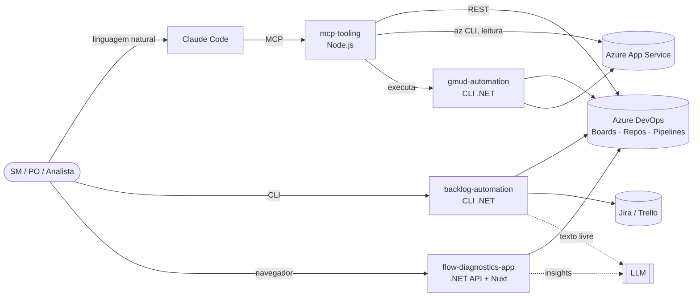
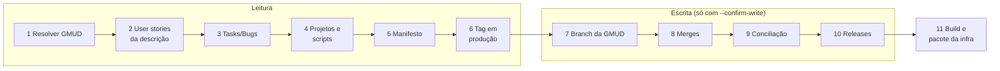

# 🤖 AgileOps Copilot

> Automação com IA para o trabalho operacional de **Scrum Master, Product Owner e Analista de Sistemas**:
> do documento de requisitos ao backlog no board, da GMUD manual à release preparada por um pipeline
> auditável, e da sprint atrasada ao diagnóstico do gargalo.

**.NET 10 · C# · Node.js · Nuxt/Vue · Azure DevOps REST · Azure App Service · MCP (Model Context Protocol) · LLM**

`402 testes automatizados` · `4 módulos independentes` · `nenhuma escrita sem confirmação explícita`

---

## Em 30 segundos

| | |
|---|---|
| **Problema** | Em times ágeis, boa parte do tempo de SM/PO/Analista vai para tarefas repetitivas e propensas a erro: transformar documentos em cards, preparar a mudança de produção (GMUD) juntando branches de várias user stories, e descobrir *por que* a sprint travou. |
| **Solução** | Quatro ferramentas que automatizam essas frentes, conversam entre si e podem ser operadas por linguagem natural através de um assistente de IA (Claude Code) via MCP. |
| **Diferencial** | Automação que **escreve em sistemas de produção** (repositórios, boards) com as mesmas garantias de um processo humano cuidadoso: simulação antes, confirmação explícita, idempotência, rastreabilidade e zero segredo no código. |

## O que tem aqui

| Módulo | Problema que resolve | Destaques técnicos |
|---|---|---|
| 🔀 [`gmud-automation/`](./gmud-automation) | Preparar uma GMUD exigia horas de trabalho manual: ler cards, achar as branches de cada user story, partir da versão que está em produção, fazer merges, resolver conflitos, criar releases e montar o pacote para a infra. | Pipeline de **11 etapas** com manifesto JSON idempotente (retoma de onde parou), `--dry-run`, gate `--confirm-write`, conciliação de conflitos com aprovação humana, **cenários BDD** com fakes em memória. **217 testes.** |
| 🧱 [`backlog-automation/`](./backlog-automation) | Converter atas, e-mails e documentos de requisitos em Epics → Features → User Stories → Tasks leva tempo e perde informação (estimativas, critérios). | Parser determinístico para documentos estruturados (Word/Markdown, sem IA) e LLM só para texto livre; valida INVEST/Gherkin; cria os cards no **Azure DevOps, Jira ou Trello** já na hierarquia. **96 testes.** |
| 📊 [`flow-diagnostics-app/`](./flow-diagnostics-app) | O board mostra *o que* está atrasado, mas não *onde* o fluxo trava nem *por quê*. | API .NET + Nuxt/Vue: Cycle Time por etapa, baseline estatístico (média + desvio), itens críticos e insights gerados por LLM. Inclui o [**Sprint Risk Bot**](./flow-diagnostics-app/SPRINT-RISK-BOT.md): cruza as Horas Estimadas entregues com a capacidade diária restante do time, projeta o atraso e alimenta um System Prompt dinâmico; dashboard responsivo com atualização automática. **82 testes.** |
| 🔌 [`mcp-tooling/`](./mcp-tooling) | O assistente de IA não enxerga o Azure DevOps nem os App Services. | Servidor **MCP** com tools de Boards, Repos, Pipelines, App Service e GMUD; leitura livre, escrita só com aprovação. **7 testes.** |

## Arquitetura



A regra de negócio mora em C#, testada; o MCP só orquestra. Assim, o mesmo fluxo roda pela CLI, por um
pipeline de CI ou por uma conversa com a IA, sem duplicar lógica.

### O pipeline de GMUD (o módulo mais complexo)



- **Parte do que está em produção, não de uma branch qualquer.** A etapa 6 lê a imagem do container
  publicada no App Service (`<buildId>-<branch>-<commitSha>`) e a branch da GMUD nasce exatamente desse commit.
- **Cada etapa é uma classe** (`IGmudStep`: manifesto → manifesto) registrada numa factory; adicionar uma etapa
  não mexe nas outras.
- **Manifesto como fonte da verdade.** Cada etapa grava status e resultado; reexecutar retoma da primeira
  pendente sem duplicar branches nem sobrescrever releases.
- **Humano no circuito onde importa.** Conflito ambíguo, App Service fora do padrão ou branch ausente param o
  fluxo com código de saída 2 e um relatório legível; a decisão do operador é registrada no manifesto.
- **Saída para a infra.** Um `infra.md` com tag atual → nova tag por App Service, scripts de banco na ordem e
  links das branches, pronto para anexar à GMUD.

## Decisões de segurança

Automação que escreve em repositórios e boards de produção precisa ser mais conservadora que uma pessoa.
Estas regras estão no código e cobertas por testes, não só na documentação:

| Decisão | Como foi implementada |
|---|---|
| **Simular antes de escrever** | Toda escrita exige `--confirm-write`; sem ela, as etapas de escrita rodam em modo simulado e mostram o plano. No MCP, `gmud_run` é dry-run por padrão e recusa `confirm_write` junto com `dry_run`. |
| **Nunca destruir histórico** | Sem push em `main`/`master`/`develop` ou release existente, sem `--force`, sem rebase de branch publicada, sem exclusão de branch remota. Atualização de ref usa *compare-and-swap* (`oldObjectId`), então uma corrida nunca sobrescreve trabalho alheio. |
| **Escopo mínimo** | App Services e o repositório de banco são **somente leitura**: a troca de tag e a execução de scripts continuam com a infra e o DBA. |
| **Segredos fora do código** | PATs e chaves via `.env`, `dotnet user-secrets` ou variáveis de ambiente; o código verifica *se* existem, nunca imprime o valor. Configuração real (`gmud.config.json`, `gmuds/`) é ignorada pelo Git; o repositório traz só exemplos. |
| **Dado não é instrução** | Texto de cards, comentários e anexos é tratado como dado, nunca como comando, inclusive nas instruções do servidor MCP (mitigação de *prompt injection*). |
| **Entrada validada** | Comandos externos (`az`, `dotnet`) rodam sem shell; quando o shell é inevitável (Windows), nomes são validados por whitelist antes da chamada. |
| **Dados fictícios** | Todos os exemplos e testes usam a empresa fictícia **Contoso**; nenhum dado de cliente real está neste repositório. |

## Qualidade

- **402 testes automatizados** (xUnit + Moq + FluentAssertions no .NET, `node:test` no MCP), sem rede:
  clientes HTTP testados com handlers falsos e o pipeline de GMUD com um Azure DevOps em memória.
- **Cenários BDD** descrevem o processo de ponta a ponta (ex.: *"GMUD só de banco"*, *"conflito ambíguo para
  aprovação"*, *"reexecução não duplica releases"*).
- **Interfaces + injeção por construtor** em todos os clientes externos, o que mantém a regra de negócio
  testável e independente de Azure.
- **Requisitos rastreáveis**: cada módulo nasceu de Epics/User Stories com critérios de aceite, e as regras de
  negócio têm ID (`RN-GMUD-xxx`) e registro de decisões.

## Como rodar

Pré-requisitos: [.NET SDK 10](https://dotnet.microsoft.com/download), Node.js 20+ e, para o frontend,
[pnpm](https://pnpm.io). Os testes rodam sem nenhuma credencial.

```bash
# Testes de cada módulo (a partir da raiz do repositório)
dotnet test gmud-automation
dotnet test backlog-automation
dotnet test flow-diagnostics-app/backend/FlowDiagnosticsApi.Tests
(cd mcp-tooling && npm install && node --test)
```

Para usar contra um Azure DevOps real, cada módulo explica sua configuração local:
[gmud-automation](./gmud-automation/README.md) · [backlog-automation](./backlog-automation/README.md) ·
[flow-diagnostics-app](./flow-diagnostics-app) · [mcp-tooling](./mcp-tooling/README.md).

<details>
<summary>Flow Diagnostics (interface web)</summary>

```bash
# Backend
cd flow-diagnostics-app/backend
dotnet user-secrets set "LlmSettings:ApiKey" "<sua-chave>"
dotnet user-secrets set "AzureDevOpsSettings:PersonalAccessToken" "<seu-pat>"
dotnet user-secrets set "AzureDevOpsSettings:Organization" "<sua-organizacao>"
dotnet user-secrets set "AzureDevOpsSettings:Project" "<seu-projeto>"
dotnet run    # http://localhost:5250 (documentação da API em /scalar/v1)

# Frontend (outro terminal)
cd flow-diagnostics-app/frontend
pnpm install
pnpm run dev  # http://localhost:3000
```

</details>

<details>
<summary>Do documento ao backlog em 3 passos</summary>

```bash
cd backlog-automation

# 1. Prévia: gera o backlog e valida as boas práticas (somente leitura)
dotnet run --project BacklogAutomation.Cli -- plan --file requisitos.docx --out backlog.json

# 2. Revise/ajuste o backlog.json

# 3. Cria os cards já na hierarquia, com story points e horas
dotnet run --project BacklogAutomation.Cli -- create --plan backlog.json \
  --url "https://dev.azure.com/sua-org/Seu Projeto" --confirm-write
```

</details>

## Como foi construído

Projeto pessoal, desenvolvido a partir de problemas reais do meu dia a dia com gestão ágil e release
management, e generalizado para dados fictícios. Usei IA (Claude Code) como par de programação; a
especificação, as regras de negócio, as decisões de arquitetura e segurança e a validação são minhas.
Os subprojetos foram especificados como Epics e User Stories com critérios de aceite antes do código.

## Autor

**Charles Pires Rodrigues**: Scrum Master / Product Owner / Analista de Sistemas com foco em engenharia
de IA aplicada.

Licença [MIT](./LICENSE).
