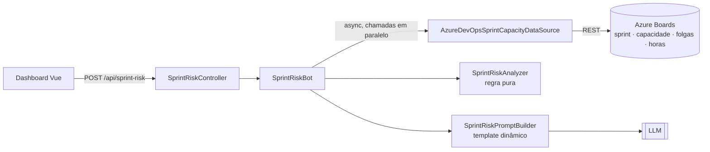

# 🎯 Sprint Risk Bot

Bot preditivo que avisa o Scrum Master, **antes do fim da sprint**, se o time vai atrasar e por quê.
Entregue na **Feature 8 — Gestão de Projetos com IA** (Epic #146), dentro do `flow-diagnostics-app`.

| Item | Entrega |
|---|---|
| PBI 8.1 · Task 1 | Regra analítica no backend .NET, isolada de I/O ([`SprintRiskAnalyzer`](./backend/Services/SprintRisk/SprintRiskAnalyzer.cs)) |
| PBI 8.1 · Task 2 | Template dinâmico do System Prompt alimentado pelos dados da API ([`SprintRiskPromptBuilder`](./backend/Services/SprintRisk/SprintRiskPromptBuilder.cs)) |
| PBI 8.2 · Task 1 | Views e componentes do dashboard em Vue + Tailwind ([`pages/sprint-risk.vue`](./frontend/app/pages/sprint-risk.vue), `components/SprintRisk*.vue`) |
| PBI 8.2 · Task 2 | Integração com o endpoint `POST /api/sprint-risk` ([`useSprintRisk`](./frontend/app/composables/useSprintRisk.ts)) |

## Como funciona



1. **Coleta assíncrona (AC 8.1-1).** A sprint atual do time (ou a informada), os dias úteis, as folgas do time
   e de cada membro, a capacidade por membro (soma das atividades) e as horas dos work items. Chamadas
   independentes rodam em paralelo (`Task.WhenAll`).
2. **Análise (AC 8.1-2).** Cruza as **Horas Estimadas entregues** com a **capacidade diária restante**:

   | Indicador | Cálculo |
   |---|---|
   | Utilização | trabalho restante ÷ capacidade restante (capacidade/dia × dias úteis disponíveis, sem folgas) |
   | Ritmo observado | Horas Estimadas dos itens entregues ÷ dias úteis decorridos |
   | Ritmo necessário | trabalho restante ÷ dias úteis restantes |
   | Atraso projetado | trabalho restante ÷ ritmo observado − dias úteis restantes |

   Alertas: capacidade estourada ou esgotada, ritmo abaixo do necessário, membro sobrecarregado ou sem
   capacidade, trabalho sem responsável, itens sem estimativa, capacidade/horas não cadastradas e sprint
   encerrada com pendências. O nível de risco (No prazo / Em risco / Crítico) é o pior alerta.
3. **Parecer da IA.** O template do System Prompt recebe os números já calculados; a LLM só interpreta e
   recomenda ações. Se a LLM falhar, o relatório sai sem parecer, mas com toda a análise.
4. **Dashboard.** Indicadores, projeção do trabalho restante, rosca de entrega, carga por membro e alertas com
   link para os work items. Atualização automática (30 s, 1 min, 5 min ou manual) sem chamar a LLM a cada
   ciclo, e pausa com a aba em segundo plano. Layout responsivo do celular ao desktop.

## Uso

Com o backend e o frontend rodando (ver [README principal](../README.md)), abra `http://localhost:3000/sprint-risk`
e cole qualquer URL do Azure Boards do projeto. Sem time/sprint, o bot analisa a sprint atual do time padrão
(`<Projeto> Team`).

```bash
curl -X POST http://localhost:5250/api/sprint-risk -H "Content-Type: application/json" \
  -d '{"boardsUrl":"https://dev.azure.com/sua-org/Seu%20Projeto","team":"Seu Projeto Team","includeAiInsight":true}'
```

O PAT precisa dos escopos de leitura **Work Items** e **Project and Team**. Ele pode ir na requisição
(`personalAccessToken`) ou ficar no servidor via `dotnet user-secrets set "AzureDevOpsSettings:OrganizationTokens:<org>" "<pat>"`.

Para a previsão funcionar, a sprint precisa ter **datas**, **capacidade cadastrada** (Sprints › Capacity) e
**Original Estimate / Remaining Work** nas tasks; quando faltam, o bot avisa em vez de prever no escuro.

## Configuração (`SprintRiskSettings` no `appsettings.json`)

| Chave | Padrão | Uso |
|---|---|---|
| `WarningUtilizationThreshold` / `CriticalUtilizationThreshold` | 0.85 / 1.0 | Faixas de utilização para atenção e crítico |
| `PaceToleranceRatio` | 0.9 | Ritmo observado abaixo de 90% do necessário gera alerta |
| `CriticalSlipWorkingDays` | 2 | Atraso projetado que torna o alerta de ritmo crítico |
| `HourTrackedWorkItemTypes` | Task, Bug | Tipos que carregam horas (PBIs ficam fora para não contar em dobro) |
| `DoneStates` / `ExcludedStates` | Done, Closed, Resolved / Removed | Estados de entregue e ignorados |
| `TimeZoneId` | America/Sao_Paulo | Fuso do "hoje" e dos dias úteis |
| `SystemPromptTemplate` | (padrão embutido) | Template próprio com placeholders `{{nome}}`; um placeholder desconhecido impede a API de subir |

## Testes

`dotnet test flow-diagnostics-app/backend/FlowDiagnosticsApi.Tests`: 41 testes do bot (regra analítica com
relógio fixo, template do prompt, coletor com HTTP falso, bot, parecer da IA e controller), sem rede.
